<p align="center">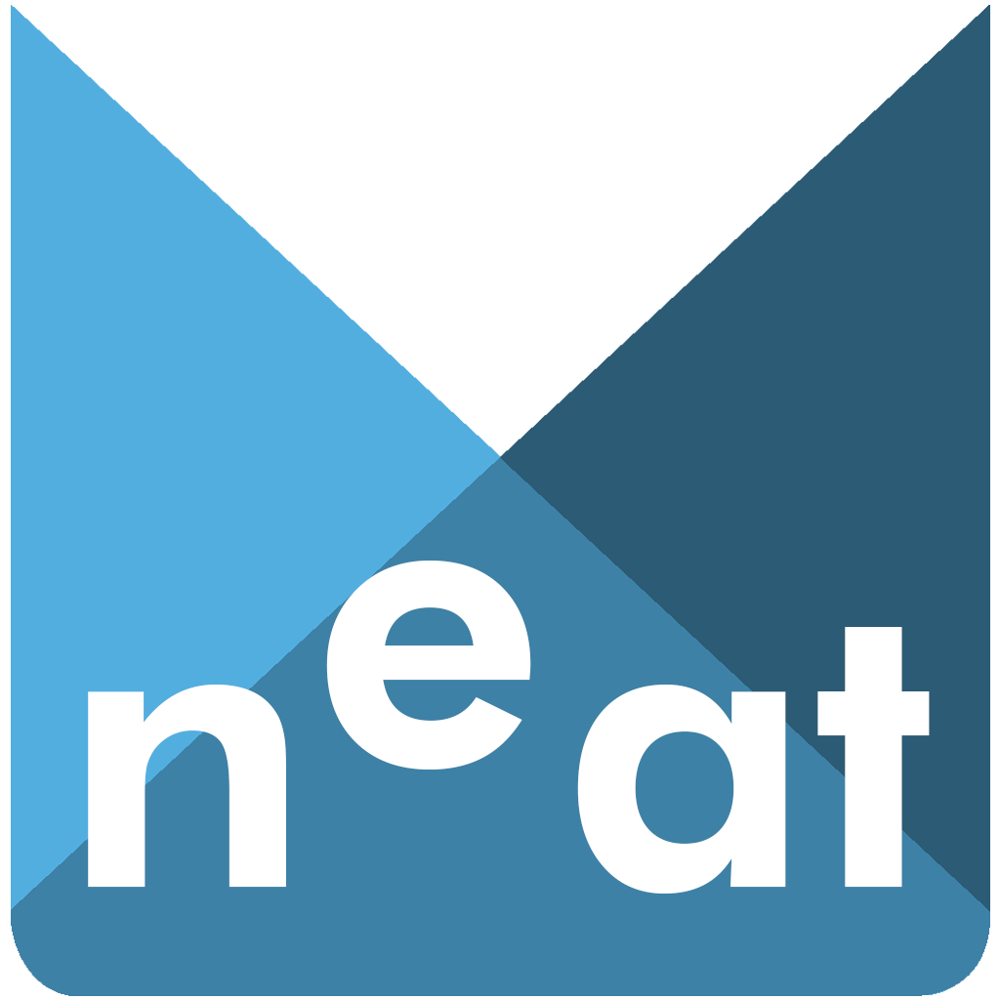</p>


> [!WARNING]
> **This is a hobby project, so shits can happen during the usage of this tool, but virus and malware free!**
**The below mentioned tools has nothing to do with *Remedy Games / Remedy Entertainment* (not provided any support or code), the codebase developed by me!**

> [!IMPORTANT]
> To run n<sup>e</sup>at you will need installed [.NET Desktop Runtime 10](https://dotnet.microsoft.com/en-us/download/dotnet/10.0). n<sup>e</sup>at developed on **Windows 11**!
> The release contain Windows, Linux and macOS version, but only Windows version was tested!

# About n<sup>e</sup>at

The tool was created for [Northlight Engine](https://www.remedygames.com/northlight) Archive files to extract / repack / create.
The **Northlight Engine Archive Tool** (neat) is the rewritten version of the original **Alan Wake Tool** and later the **Northlight Tool**. None of those name cover now the real purpose and function of the tool, that's why I moved those function to a new and renamed project.

The Alan Wake Tool was created originally for Alan Wake Xbox360/PC only, to unpack archives and replace files inside them, mainly the localisation file.
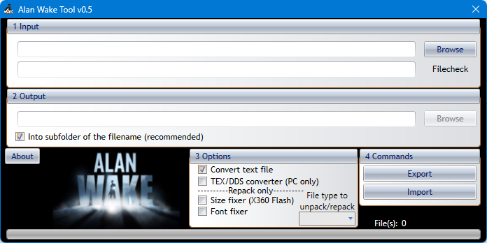

When the non-Alan Wake game was released (Quantum Break), using the name Alan Wake Tool was pointless, also the developers changed the name of the game engine from (non official) **Alan Wake engine**, to **Northlight**.
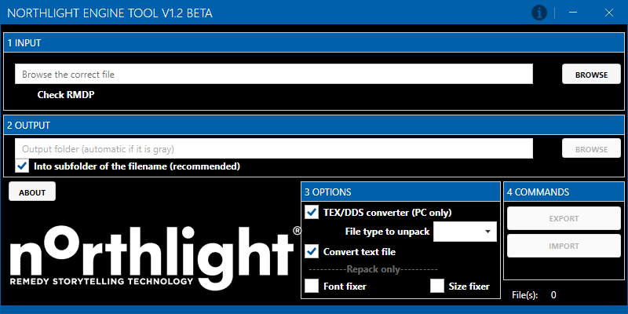

Because Northlight Engine Tool codebase is from Alan Wake Tool with little change and updated GUI, all the lacky coding and poor archive handling and reading was still present in the tool.
The tool **n<sup>e</sup>at** was built up from scratch and unlike its predecessors, rewritten completely in Object-oriented programming (OOP) way. Or at least I tried to.
The tool can read and create Northlight archive file (bin/rmdp). The repacked files are still not equal with the original files, but 99% of the time the game engine able to use the new archive file!
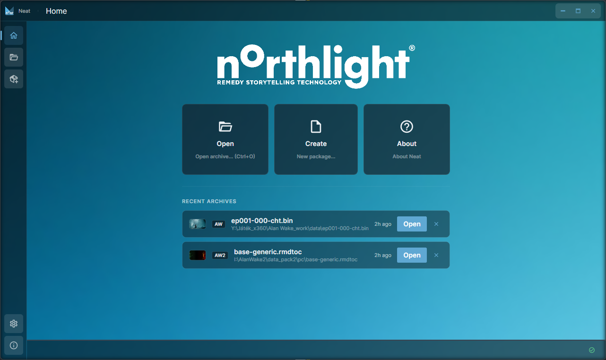

<h3>Features</h3>

- [x] Unpack archive files
- [x] Create new archive file
- [x] Convert binary text file to txt and back
- [x] Convert textures with .tex extension to DDS (DirectDraw Surface) format and back
- [x] Different backgound image for each game
- [x] Not supporting .packmeta, .xml companion files creation because it seems the game not using them
- [ ] Will not support 3D files, media files etc. For those please check other solution, like [OpenAWE](https://github.com/OpenAWE-Project/OpenAWE)

<h3>Supported games</h3>

(for up-to-date list please always check the About page inside the tool)
| Game | Tested Platform |Engine version<br />(not official)| Development<br />(Read/Write) |
| ----------- | ----------- | ----------- | ----------- |
Alan Wake | Xbox360 / PC | v1.2 | :white_check_mark: / :white_check_mark:
Alan Wake's American Nightmare | Xbox360 / PC | v1.7 | :white_check_mark: / :white_check_mark:
Quantum Break | PC | v1.8 | :white_check_mark: / :white_check_mark:
Control | PS4 / PC | v1.9 | :white_check_mark: / :white_check_mark:
Alan Wake Remastered | PS4 / PC / NSW | v1.2.9 | :white_check_mark: / :white_check_mark:
CrossfireX / Crossfire HD | XboxOne / SeriesX | v1.10 | :white_check_mark: / :white_check_mark:
Alan Wake II | PS5 / PC | v2.2 | :white_check_mark: / :white_check_mark:
FBC: Firebreak | PC | v2.2 | :white_check_mark: / :white_check_mark:
Control Resonant | PC | v2.3 | :white_check_mark: / :white_check_mark:
Max Payne 1 & 2 Remake | PC | v2.? | Planned

---
<h2>About Northlight Engine</h2>

Northlight is a game engine, created and developed by Remedy Entertainment.
The engine introduced with Alan Wake game in 2010 on Xbox360. Back then the engine had no public name, so everyone called it Alan Wake Engine. This was not changed until Quantum Break, when the engine was named officially to Northlight. On the surface, on the archivum/container file level, not much changed. This is why my tools (AW Tool, Northlight Tool, n<sup>e</sup>at) were/are backward compatible since first Alan Wake. Of course in the background of the engine evolved since the beginning hugely, added more and more new features.

The Northlight Engine games:
- 2010 - Alan Wake (under Alan Wake engine)
- 2012 - Alan Wake's American Nightmare (under Alan Wake engine)
- 2016 - Quantum Break
- 2019 - Control 
- 2021 - Alan Wake Remastered
- 2022 - CrossfireX / Crossfire HD (single-player)
- 2023 - Alan Wake II
- 2025 - FBC: Firebreak
- 2026 - Control Resonant
- ???? - Max Payne 1 & 2 Remake

[Northlight Engine](https://www.remedygames.com/northlight/)
[Remedy Games](https://www.remedygames.com)


---
<h2>How to modding, (Engine v1.x)</h2>
The base concept of modding is to do not change the original files, but adding new contents or replace existing files with new archive files contain the updated engine files. So in this case create new archive files with minimal size.

The tool can unpack the original archive files, but not change their content!


So unpack all the bin/rmdp archive files (make sure you have enough free space for this step) and find the files you want to change. Modify them (ie. redraw textures) and place the modified files into a new folder with the correct folder/subfolder structure.
If you modify an unpacked file like: ep100-000-generic\folder1\folder2\texture.tex
Follow the folder structure in the new folder also: myNewFolder\folder1\folder2\texture.tex

If you not use the correct folders/subfolder and filenames, the game won't use the modified files from the mod container!

For the new file the name is also very important. If you unpacked from (Control game) ep100-000-generic archive, you HAVE TO use this name, but increase the number of the filename, like ep100-00**1**-generic. If there is already a "001" then increase until the file is not exist.

Examples:<br/>
ep100-000-generic-en -> ep100-00**1**-generic-en<br/>
ep100-000-pc -> ep100-00**1**-pc<br/>
ep101-000-pc -> ep101-00**1**-pc

<br/>

**Creating files with GUI**

- Open the program, select from the Home page or from the sidebar the Create/New Package button
- Select the game (Because spackages are different only the selected game will able to use the package)
- Select the output file (enter the filename, like "ep100-000-pc", but you can rename them later manually)
- Select the source folder (with the modified files) Important, that here ou can repack anything, but if the files were not in the original containers, the game will not use them. The same case if you try to a language file in the generic file, where no language files by default.
- using the Create button the package created and opened in Neat

**Creating files with CLI (not the GUI!)**

```
neat.exe create ep100-000-pc --game quantum-break --source newfiles
```
- [ep100-000-pc] - name of the output files (bin/rmdp), that could be different by games and containers
- [newfiles] = the folder with the modified files

<br/>

<h2>How to modding, (Engine v2.x)</h2>

> [!NOTE]
> In case of Engine v2 the Modding is just partially supported, meaning the updating the .rmdtoc file is inevitable.

**Creating files with GUI**

- Open the program, select from the Home page the Open button, or drag@drop the game container file. **Always use the original files, because you will see below, the tool create new blob file once you save the changes.**
- Navigate to the folder where you plan to add folder with files or just files
- From the top buttonbar select Files button to add files, or Folder button to add folder (with files including subfolders) to the currently selected folder
- New or updated files will be tagged in the State column until saving
- Use the Save button from the top buttonbar. The .rmdtoc file will be updated and a backup will bre created with extension .bak. At the same time new changes, the new files will be added to a new blob file. For example if the opened package is "base-generic", and exist a "base-generic-001.rmdblob" file, the new files will be added to file "base-generic-00**2**.rmdblob".
- IF the container has only 1 blob file [filename-000.rmdblob], the in-place option is available, which import the modified files from the source folder into the 000 blob file and not create a new with [filename-001.rmdblob]. Creating new blob also available here.

**Creating files with CLI (not the GUI!)**
```
neat.exe update base-generic --source newfiles
```
- [base-generic] - name of the container file you plan to update files inside
- [newfiles] = the folder with the modified files

---
## n<sup>e</sup>at screenshots
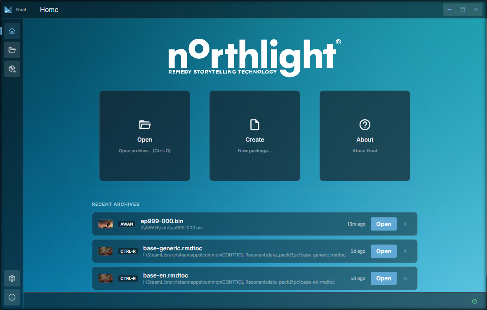
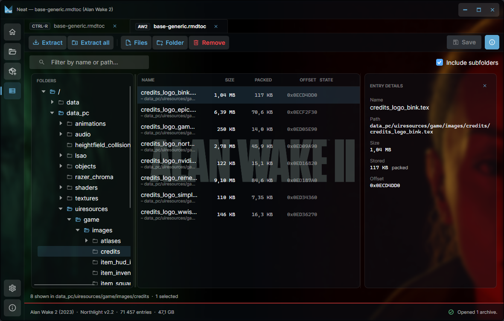
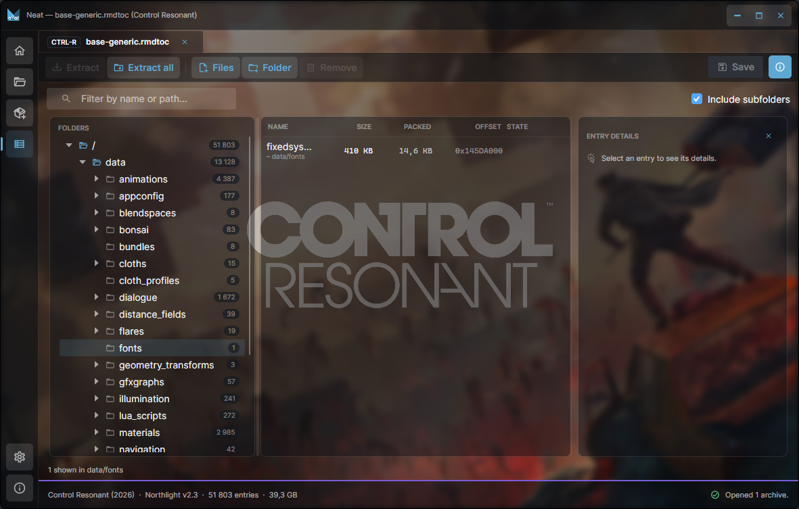
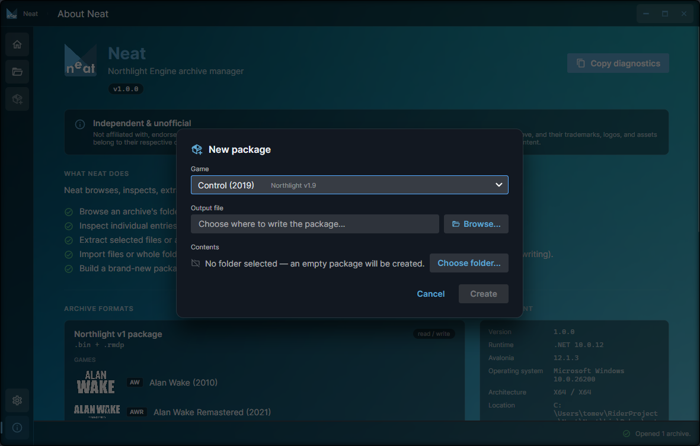

<h2>Northligt Tool screenshots</h2>
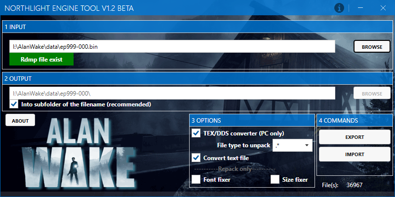 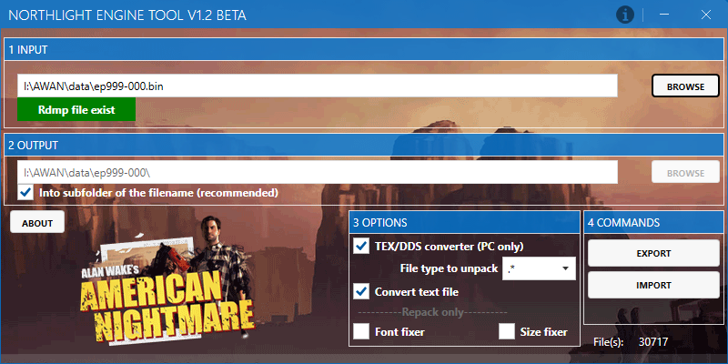
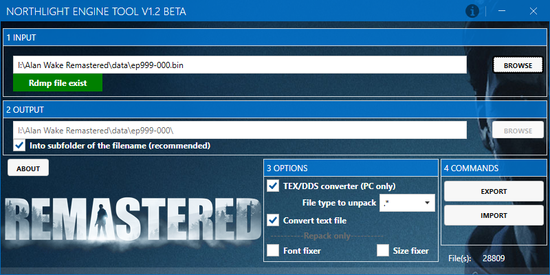 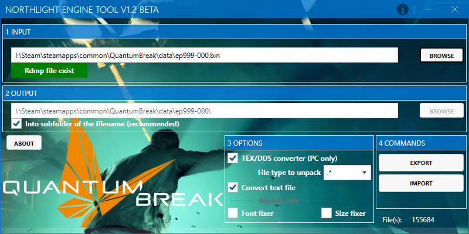
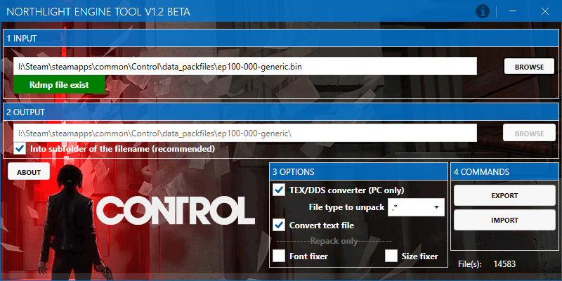 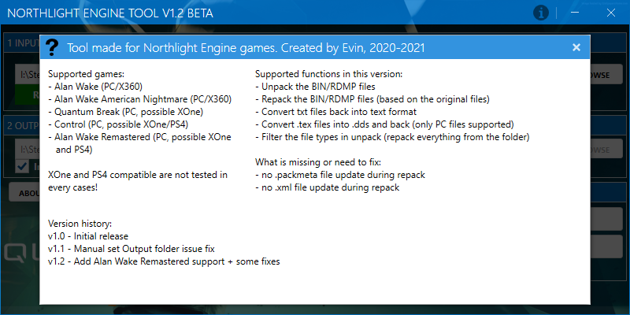
